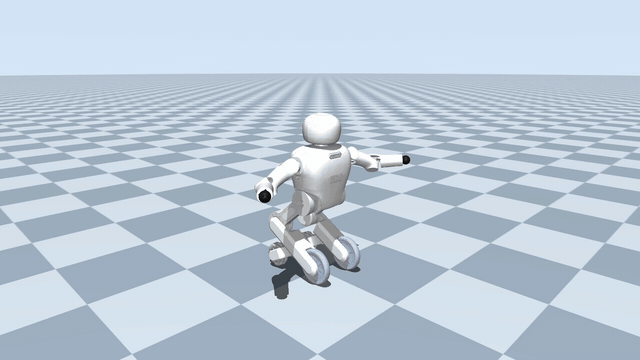

# JC04 Dancing / 小楚机器人舞蹈仿真

小楚 JC04 在 **MuJoCo 3.3.7** 中演绎《天鹅湖》。重新编排的动作把大幅前举、屈肘收展、左右斜向应答、髋膝起伏与轮式滑行转向写入同一份 CSV，由同一仿真时钟执行。

[](https://gcwhust.github.io/JC04_dancing/#swan-lake)

**[▶ 观看完整有声视频](https://gcwhust.github.io/JC04_dancing/#swan-lake)** · 1920 × 1080 · 30 FPS。上方 GIF 无声，点击打开有声播放器。

## 机器人与仿真


轮足机器人 JC04 具有 **12 个主动自由度**：下肢包括左右髋关节、左右膝关节和左右主动轮，共 6 个自由度；上肢包括左右肩部俯仰、肩部横滚及肘部俯仰关节，共 6 个自由度。头部下方为躯干，两侧为双臂；髋膝连杆连接躯干与主动轮，辅助轮用于四轮模式的支撑。

舞蹈采用自由浮动机身和真实轮地接触。10 个臂腿关节通过 PD 力矩控制，两个主轮通过轮速闭环控制；辅助轮增加被动滚动关节，并以低摩擦接触近似其滚子结构。CSV 中的轮速驱动机身移动，播放过程不改写机身位置。物理步长为 0.0005 秒，镜头跟随实际机身水平位置。

模型来自 jc04_desc4 V1.3。碰撞外形、辅助轮和摩擦参数为仿真近似，未验证真机动作范围；`supported` 模式固定机身，仅供调试。[模型转换说明](docs/model-conversion.md)记录具体设置。

## 安装

已使用的环境为 Ubuntu 22.04 x86_64、Python 3.10.22。以下命令在仓库根目录执行：

```bash
git clone https://github.com/gcwhust/JC04_dancing.git
cd JC04_dancing
sudo apt-get update
sudo apt-get install -y libegl1 libgl1 libglfw3 libosmesa6
conda env create -f environment.yml
conda activate jc04_dancing
python -m pip install .
```

模型、网格、动作 CSV、配乐和中文字体随安装包提供，无需原始控制工程。FFmpeg 由 `imageio-ffmpeg` 提供。安装后也可从其他目录运行。

## 复现完整仿真与有声视频

### 1. 检查与交互播放

```bash
python -m jc04_dancing list
MUJOCO_GL=egl python -m jc04_dancing check --dance swan_lake --mode free
# 有桌面的终端可打开交互窗口
python -m jc04_dancing play --dance swan_lake --mode free
```

`check` 完整执行物理仿真，输出跌倒、数值警告、关节误差、轮速和移动距离等信息。交互窗口展示动作；音乐在视频合成步骤加入。

### 2. 录制画面

```bash
MUJOCO_GL=egl python -m jc04_dancing record \
  --dance swan_lake --mode free \
  --output outputs/reproduced/dance.mp4
```

默认完整录制 **99 秒、2970 帧**（2 秒准备 + 94 秒主体 + 2 秒回位 + 1 秒保持），1920 × 1080、30 FPS 的 H.264 视频，并保存 `run.json` 和实际帧截图 `stills/`。输出目录必须为空；重录时使用新的目录。首次模型加载和完整录制可能需要数分钟。

无桌面环境需在启动 Python 前设置 `MUJOCO_GL=egl`，并安装可用的 EGL/显卡驱动。短预览可追加 `--duration 10 --width 960 --height 540`，画面会标注 PREVIEW，不能作为正式材料。

### 3. 合成《天鹅湖》配乐

```bash
python -m jc04_dancing add-audio \
  --run-dir outputs/reproduced \
  --output outputs/reproduced_audio
```

生成 `outputs/reproduced_audio/dance.mp4`。默认使用包内《天鹅湖》节选，从第 2 秒的舞蹈主体起点进入，按原速播放。合成保留视频编码，逐帧核对画面，检查 AAC 立体声音轨确有非静音内容。前奏准备与回位留有短暂静音。

用浏览器或普通播放器打开有声 MP4；VS Code SSH 内置预览的音频支持可能不同。播放器音量需打开。音乐来源、节选范围和时间点见[配乐说明](docs/audio-provenance.md)，编排与数据说明见[动作说明](docs/dance-analysis.md)。

### 4. 生成设计说明与比赛材料

```bash
python -m jc04_dancing report \
  --run-dir outputs/reproduced_audio \
  --output outputs/reproduced_report/report.pdf

python -m jc04_dancing submit \
  --run-dir outputs/reproduced_audio \
  --output submission --source-root .
```

设计说明包括小楚机器人介绍、仿真平台与机器人模型图片、运行流程。提交工具根据 [submission.yaml](src/jc04_dancing/configs/submission.yaml) 生成命名视频、PDF、独立流程图、源码 ZIP、运行记录和 SHA256 校验单；已有材料不覆盖。

## 调整编排与验证

舞蹈数据为 `src/jc04_dancing/assets/motions/swan_lake.csv`。角度单位为度，左右轮速单位为 rad/s，时间单位为秒。生成器和音乐时间点随源码提供，修改后需重新检查、录制与合成，避免材料对应不同版本。

```bash
# 重新生成默认 CSV 与音乐段落时间表
PYTHONPATH=src python tools/generate_swan_lake.py
# 修改源码/数据后重新安装，再重新录制
python -m pip install .
python -m pip install '.[dev]'
MUJOCO_GL=egl python -m pytest -q
```

[验证记录](docs/validation.md) · [比赛要求对应](docs/competition-requirements.md) · [素材来源](src/jc04_dancing/assets/licenses/ASSET-NOTICES.md)

本次动作由参数化编舞生成器重新编排；未包含原始控制工程。模型、音乐、字体保留各自来源和许可。仿真结果不代表真机验证。
