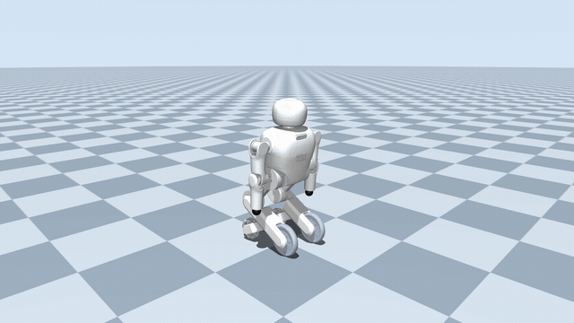
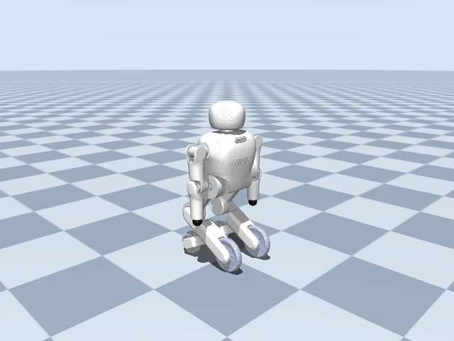

# JC04 Dancing / 小楚机器人舞蹈仿真

基于 **MuJoCo** 的小楚 JC04 机器人舞蹈仿真工程，包含机器人模型、四支舞蹈、视频录制、配乐、中文设计说明及提交材料生成工具。小楚拥有 **12 个自由度**：下肢 6 个（双髋、双膝、双驱动轮），上肢 6 个（双肩 pitch / roll、双肘 pitch）。

## 舞蹈预览

[](https://gcwhust.github.io/JC04_dancing/)

**[▶ 观看完整有声视频](https://gcwhust.github.io/JC04_dancing/)** · 83.333 秒 · 1920 × 1080 · 30 FPS

预览 GIF 无声；点击后可播放完整视频。配乐从第 2 秒、舞蹈主体开始时进入。

## 仿真模型



模型保留全部 12 个活动关节。默认 `free` 模式下机身可自由运动，双驱动轮采用角位置约束模拟锁止，10 个臂腿关节由力矩控制器驱动。**锁轮不冻结机身在世界坐标中的位置**，物理步长为 **0.0005 秒**。

`supported` 模式会固定机身，仅用于调试。肩 roll 和肘 pitch 的仿真限位为容纳舞蹈有所扩展，尚未验证真机活动范围；接触、自碰撞和辅助轮也采用简化模型。详见[模型转换与接触说明](docs/model-conversion.md)。

## 安装

已验证环境：**Ubuntu 22.04 x86_64、Python 3.10.22、MuJoCo 3.3.7**。以下命令在仓库根目录执行；请先安装 Conda。

```bash
git clone https://github.com/gcwhust/JC04_dancing.git
cd JC04_dancing

sudo apt-get update
sudo apt-get install -y libegl1 libgl1 libglfw3 libosmesa6

conda env create -f environment.yml
conda activate jc04_dancing
python -m pip install .
```

环境文件使用 `requirements-lock.txt` 锁定依赖。安装包自带模型、网格、动作 CSV、配乐、报告字体和模板，安装后可在其他目录运行。视频编码使用 `imageio-ffmpeg` 提供的 FFmpeg，无需另装系统 FFmpeg 或中文字体。

## 查看与播放舞蹈

内置四支舞蹈，原动作采样率均为 24 FPS：

| 参数 `--dance` | 舞蹈 |
|---|---|
| `new_year` | 新年（默认） |
| `doudoulong` | 豆豆龙 |
| `shuangjiang` | 双桨 |
| `lion` | 舞狮 |

在有桌面的终端打开交互仿真窗口：

```bash
python -m jc04_dancing list
python -m jc04_dancing play --dance new_year --mode free
```

关闭窗口即可结束播放。交互播放展示机器人动作，配乐在后续视频合成时加入。

无桌面环境可先列出舞蹈并检查完整仿真：

```bash
MUJOCO_GL=egl python -m jc04_dancing list
MUJOCO_GL=egl python -m jc04_dancing check --dance new_year --mode free
```

`check` 输出包含仿真时长、跌倒状态和数值警告的 JSON。无头渲染需要可用的 EGL；使用 NVIDIA GPU 时还需相应驱动。务必在启动 Python 前设置 `MUJOCO_GL=egl`。支持 OSMesa 的系统也可尝试 `MUJOCO_GL=osmesa`，本项目已验证的后端为 EGL。

## 完整复现：录像 → 配乐 → 报告 → 提交包

### 1. 录制完整仿真

```bash
MUJOCO_GL=egl python -m jc04_dancing record \
  --dance new_year --mode free \
  --output outputs/reproduced/dance.mp4
```

默认录制全长 **1920 × 1080、30 FPS** 视频。`new_year` 生成 **2500 帧、83.333 秒** 的无声 H.264 视频，并保存 `run.json` 和 `stills/` 截图。录制耗时取决于硬件，首次运行可能需要数分钟。

仅预览时可追加 `--duration 5 --width 960 --height 540`；正式报告需使用完整录像。录像目录必须为空，重录时请换一个输出目录。

### 2. 加入配乐

```bash
python -m jc04_dancing add-audio \
  --run-dir outputs/reproduced \
  --output outputs/reproduced_audio
```

生成 `outputs/reproduced_audio/dance.mp4`，保留原视频画面和时间轴，加入 AAC 立体声音轨。默认使用包内配乐，原速从 **2 秒** 开始，淡入 0.4 秒、淡出 0.8 秒，音乐结束后补静音至全片结束。

可追加 `--audio /path/to/music.mp3` 指定音乐，或使用 `--timeline-start-seconds`、`--fade-in-seconds`、`--fade-out-seconds` 调整进入时间和淡入淡出。建议用浏览器或常规视频播放器试听；部分编辑器内置预览可能不支持 AAC 音频。

### 3. 生成中文设计说明与流程图

```bash
python -m jc04_dancing report \
  --run-dir outputs/reproduced_audio \
  --output outputs/reproduced_report/report.pdf
```

输出 `report.pdf`、`report.json`、`flowchart.pdf` 和 `flowchart.png`。生成前会检查完整视频、运行记录及截图是否一致；截断预览、跌倒或有数值警告的运行不能用于正式报告。目前正式报告和提交包支持 **`new_year`**，其余三支可播放、检查和录像。

### 4. 生成提交材料

在仓库根目录执行：

```bash
python -m jc04_dancing submit \
  --run-dir outputs/reproduced_audio \
  --output submission \
  --source-root .
```

提交身份取自 [submission.yaml](src/jc04_dancing/configs/submission.yaml)。默认生成：

```text
submission/
├── ROBOT261937J_机器人舞蹈/
│   ├── ROBOT261937J_机器人舞蹈_视频.mp4
│   ├── ROBOT261937J_机器人舞蹈_文档.pdf
│   ├── ROBOT261937J_机器人舞蹈_流程图.pdf
│   ├── ROBOT261937J_机器人舞蹈_流程图.png
│   ├── ROBOT261937J_机器人舞蹈_代码.zip
│   ├── evidence/            # 运行记录与截图
│   ├── manifest.json        # 文件清单
│   └── SHA256SUMS           # SHA256 校验单
└── ROBOT261937J_机器人舞蹈_提交材料.zip
```

目录中另有报告元数据 JSON。提交命令会重新生成与该视频对应的报告，并按[源码文件清单](src/jc04_dancing/configs/source-files.txt)打包；已有提交包不会被覆盖。命令只生成本地文件，不会自动上传。

若从仓库外运行，请明确指定源码与运行目录的绝对路径，例如：

```bash
python -m jc04_dancing submit \
  --run-dir /path/to/JC04_dancing/outputs/reproduced_audio \
  --output /path/to/submission \
  --source-root /path/to/JC04_dancing
```

## 测试与进一步阅读

```bash
python -m pip install '.[dev]'
MUJOCO_GL=egl python -m pytest -q
```

- [仿真与录像验证](docs/validation.md)：运行结果、关节限位及复现记录。
- [舞蹈动作说明](docs/dance-analysis.md)：动作编排与代表姿态。
- [模型转换与接触说明](docs/model-conversion.md)：模型来源、转换和物理近似。
- [素材来源与许可声明](src/jc04_dancing/assets/licenses/ASSET-NOTICES.md)、[配乐说明](docs/audio-provenance.md)：各类素材的来源与使用范围。

四支舞蹈编排为本队原创。模型、字体等素材保留各自许可；模型的软件许可不自动覆盖音乐作品或录音，配乐权利与节拍同步情况见上述说明。本工程用于仿真展示，仿真结果不代表真机验证。
