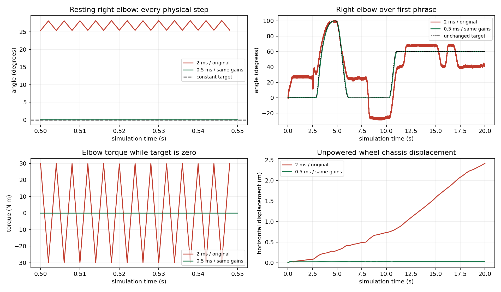

# 仿真步长与轮子锁止

默认配置使用 **0.0005秒物理步长、自由基座和锁轮约束**。步长选择依据以下
对照实验：保持 CSV、增益、限幅与接触参数一致，逐个物理步记录目标角、实际角、
速度和驱动力矩，分别改变步长与机身支撑模式。仅检查状态有限、无 MuJoCo 警告
或机身未跌倒，无法排除受限振荡。

## 原因：外部速度反馈在过大步长下形成受限振荡

本项目的 MuJoCo 仿真把 `kp*(target-q)-kd*qvel` 计算成普通 motor 的 `ctrl` 数值，再调用
`mj_step`。低惯量手臂在2毫秒步长下反复越过目标速度，阻尼项下一步反向，力矩
在正负30 N·m之间快速切换。限幅使状态保持有限，但不能消除这种振荡。

仅改变步长，比较新年完整时间轴2–20秒（自由基座、被动轮对照配置）：

| 指标 | 0.002 s | 0.001 s | 0.0005 s |
|---|---:|---:|---:|
| 右肘相邻步力矩换向比例 | 99.978% | 1.372% | 0.031% |
| 右肘力矩饱和比例 | 81.047% | 0.611% | 0 |
| 右肘最大速度（rad/s） | 40.443 | 19.796 | 2.437 |
| 右肘20 Hz以上角度 RMS（度） | 1.198959 | 0.043524 | 0.000016 |
| 前20秒最大机身水平位移（m） | 2.417158 | 0.053904 | 0.033958 |

相同窗口内原右肘目标的20 Hz以上 RMS约0.00009度，证明高频运动不是原编舞。
启用机身 supported 焊接后，2毫秒仍有约70–72%的肘力矩饱和、约100%的逐步
换向，因此抖动主因不是基座自由度或轮地接触。0.001秒仍有肩关节约29 rad/s
的瞬时速度；0.0005秒降至约5.38 rad/s，故最终采用0.0005秒，而不是只减半。
高频 RMS使用4阶、20 Hz高通及前后向滤波；原始逐步记录同时用于换向/限幅检查。

初态质量矩阵与外部阻尼矩阵的 `dt * lambda_max(M^-1 Kd)` 在三个步长下分别为
3.566、1.783、0.891。这是局部线性诊断，不是对整个接触系统的稳定性证明；
它与显式阻尼在低惯量自由度上的数值失稳相符。

[MuJoCo 3.3.7积分说明](https://mujoco.readthedocs.io/en/3.3.7/computation/index.html#numerical-integration)
说明隐式积分使用引擎已知的速度导数。
[该版本的实际导数实现](https://github.com/google-deepmind/mujoco/blob/3.3.7/src/engine/engine_derivative.c#L737)
从原生执行器的 bias/gain 速度参数求导；普通 motor 外部传入的 `ctrl` 值不会
自动保留 Python 表达式中的 `-kd*qvel` 导数。因此使用 `implicitfast` 并不使
此处的外部 KD 自动变为隐式控制。当前配置保留有限增益与力矩上限。

仅将步长改为0.0005秒、保持被动轮时，新年完整83.3335秒的最大水平位移
从11.9816米降至0.038831米，最大力矩18.6225 N·m，无臂力矩饱和；右/左肘高频
RMS约0.000024度。该对照表明，过大步长引起的数值抖动会驱动异常位移，减小
步长和增加轮子锁止约束分别解决不同问题。

## 轮子锁止的物理含义

当前默认 `wheels.mode: locked` 使用两条 **wheel hinge角位置 equality**模拟理想
抱闸；约束驱动轮相对腿部的转角，不把机身固定到世界。保留原12个活动关节、
floating root、十个臂腿力矩 motor、重力及地面接触。`base_support` 在 free 模式
继续禁用，播放期间不写 qpos。轮子没有新增主动驱动 motor，制动力由约束解算。

MuJoCo equality 是软约束，锁止允许很小的数值残差；运行结果记录全程最大轮角
偏移与轮速。这个理想制动没有经过真实轮电机抱闸
力矩辨识。仅为调试可显式创建 `Simulation(..., wheel_mode='passive')`，其摘要
会标明 passive。完整运行结果见 [validation.md](validation.md)。
