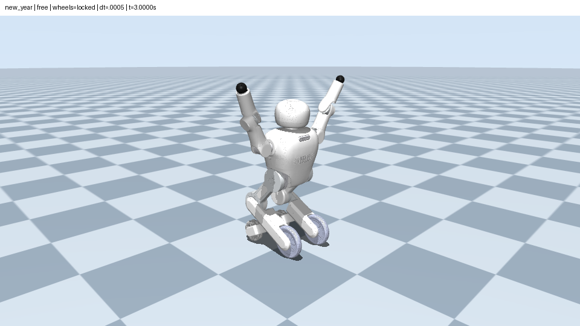
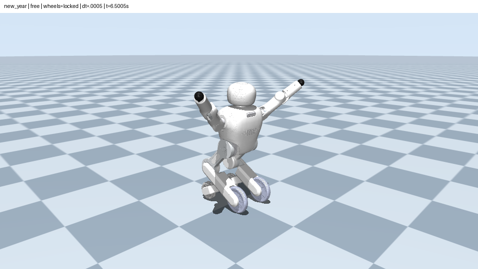
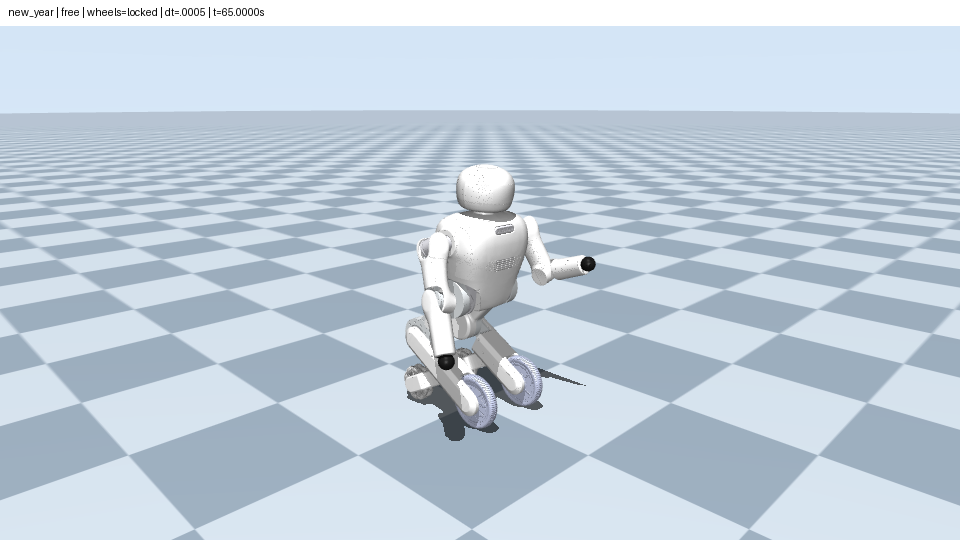
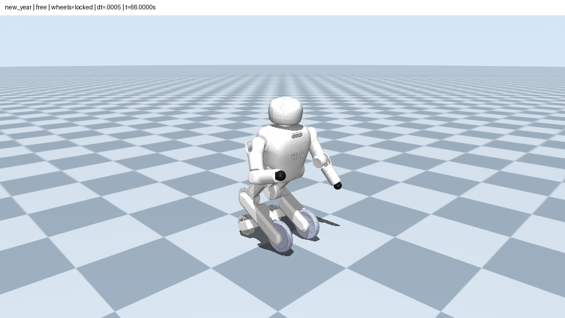

# 舞蹈采样与动作分析

## 来源和原创性

四份 CSV 来自快照 `2d224d13d624e07102a2c6eedbaf111694555e16`，均按 24 FPS 采样。源文件原字节保留在包内 `assets/motions/`；资产来源与校验值见 `assets/provenance.json`，没有改帧、裁剪、重排或变速。

四支内置舞蹈的编排为本队原创。本项目复现原编排；机器人模型另有来源说明。

| ID | 名称 | CSV | 首帧 | 主体结束时刻（秒） | 含过渡总时长（秒） |
|---|---|---|---|---|---|
| new_year | 新年（默认） | happy_new_year.csv | 0 | 1880/24 = 78.333333 | 83.333333 |
| doudoulong | 豆豆龙 | doudoulong_postprocess.csv | 1 | 1920/24 = 80 | 85 |
| shuangjiang | 双桨 | shuangjiang0307.csv | 0 | 1860/24 = 77.5 | 82.5 |
| lion | 舞狮 | shizi0307.csv | 0 | 1500/24 = 62.5 | 67.5 |

`DanceClip.start` 是首帧的绝对 `frame / fps`；`duration` 是从主体时刻零开始到最后一帧的时长，即最后帧的绝对时间，**不是**最后帧减首帧。豆豆龙在 `[0, 1/24]` 秒保持首帧，没有把第 1 帧平移到零。包内采用 `scipy.interpolate.interp1d(kind='cubic')`，按关节名匹配六个臂关节，输入为度，输出弧度。范围外保持端点而不外推。帧必须严格递增，至少四行，帧和六臂角必须有限，FPS 必须有限且为正。

## 腿部公式和展示过渡

`DanceTimeline` 按包内 `configs/robot.yaml` 的参数生成四个腿部关节的位置目标（弧度）：

```
q_hip(t)  = q_hip_rest  + radians(1) * sin(2*pi*0.25*t + phase)
q_knee(t) = q_knee_rest + radians(1) * sin(2*pi*0.25*t + phase)
right phase = 0, left phase = pi
q_hip_rest = radians(40), q_knee_rest = radians(100.7787)
```

同侧髋、膝同相。主体 1 秒时右髋/膝各 +1 度，左髋/膝各 -1 度。公式只生成四腿关节位置目标；不生成轮子目标。

准备 2 秒由 rest 连接到主体 `t=0` 的真实十关节目标；回位 2 秒从主体末帧时刻的真实十关节目标连接到 rest；再保持 1 秒。混合权重为 `3s²−2s³`。腿部在回位起点可能不在基准姿态，必须从实际末目标衔接。过渡两端位置连续，过渡自身的混合权重端点导数为零；这不声称原轨迹在接点的速度也为零。主体按原时间采样，不加混合权重、不裁剪角度。时间由调用者显式传入，无系统墙钟或采样调用历史。

## 新年实际动作类型

以下三类动作由 CSV 与实际 `free` + `wheels=locked`、0.0005秒步长、受限 PD 力矩与 `mj_step` 积分的 EGL 画面核对。角度均是源数据的度数、经四舍五入。主体时间从第 0 帧起算；完整时间轴加2秒准备。截图使用当前配置，地面棋盘固定在世界坐标。默认全程最大机身水平微动约3.34厘米、轮子相对腿部锁止残差约0.000106度，详见 [validation.md](validation.md)。

| 动作类型 | 原帧区间 | 主体时间 / 完整时间轴（秒） | 相关关节与实际证据 | 实际物理画面 |
|---|---|---|---|---|
| C01 双臂侧向展开/合拢 | 0–60 | 0–2.5 / 2–4.5 | 双肩 roll 0→约155→57；双肩 pitch 始终0；双肘0→约99.324。帧24双肩roll约155，帧60约57 | [3.0000秒展开](dance-c01-open.png)、[4.5005秒屈肘合拢](dance-c01-close.png)：双臂沿侧向弧线摆动后屈肘收拢 |
| C02 双臂前举并伸肘 | 60–120 | 2.5–5 / 4.5–7 | 双肩 pitch 0→150；肘约99.324→0；帧84肩pitch约75/肘约50，帧108肩pitch约150/肘0 | [6.5005秒](dance-c02-high.png)：双臂从屈肘姿态前举/高举并明显伸直，区别于C01侧摆 |
| C03 交替屈伸肘 | 1488–1680 | 62–70 / 64–72 | 双肩roll固定约15；肩pitch先约44.548后固定30；双肘在0–90交替。帧1512右/左肘约3.043/87.635，帧1536约86.133/3.867，帧1584为0/90 | [65.000秒](dance-c03-left.png)、[66.000秒](dance-c03-right.png)：左屈右伸切换至右屈左伸，肩姿态基本保持 |

连续时刻截图显示上述三种独立动作及肩/肘多关节协调。C03在65秒实际右/左肘角约5.96°/84.92°，66秒约81.96°/7.66°，清楚切换左右屈肘。关节位置由受力积分得到，因此与目标存在滞后。四腿同时按1度公式驱动；其幅度较小，不另计作“明显抬腿”或新的动作类型。






## 音乐状态

`record` 生成无声仿真录像，`add-audio` 在录像后加入包内新年配乐。当前带配乐成片保持原动作与视频帧不变，音乐从第2秒开始，按原速度播放并在自然结束后补静音。音频已通过解码与非静音检查；节拍或旋律与动作的配合尚未完成主观验收。来源、时长和合成参数见 [audio-provenance.md](audio-provenance.md)。
