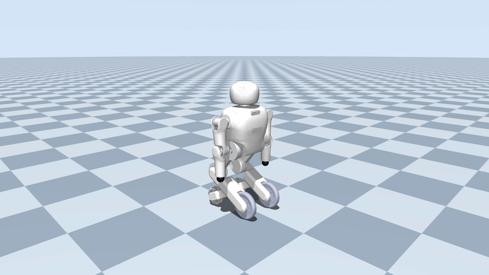

# JC04 MuJoCo 模型转换与接触

模型输入为包内 `assets/robot/jc04.urdf` 与所引用的 27 份 STL，来源为
`jc04_desc4` V1.3、快照 `2d224d13d624e07102a2c6eedbaf111694555e16`。
转换仅依赖包内资产。使用 Python 3.10.22、MuJoCo 3.3.7：

```bash
conda run -n jc04_dancing python tools/convert_model.py \
  --urdf src/jc04_dancing/assets/robot/jc04.urdf \
  --output src/jc04_dancing/assets/robot/robot.xml
conda run -n jc04_dancing python -m pytest tests/test_assets.py tests/test_model.py -q
```

转换器先将原 `base_joint` 的固定连接改为名为 `root` 的 floating 连接，再使用
MuJoCo URDF 加载和 MJCF 导出，避免把机器人固定融合到 world。固定外壳、
电池和夹爪被融合到其运动父刚体；原 12 个活动关节全部保留。
为支持轮式舞蹈，转换时仅在内存中的 URDF 副本里将两个辅助轮固定连接改为
被动滚动铰链，源 URDF 不变。编译结果为 16 个 body（含 world）、15 个 joint、
21 个 qpos、20 个自由度和 12 个 torque motor。新增两个辅助轮关节无电机，
因此仍为 12 个主动自由度。浮动基座不固定到世界。

原二进制 STL 中机身有 947904 面，两份辅助轮各有 255788 面，超出 MuJoCo
STL 导入器的 200000 面上限。转换器将它们无损转成原生 MSH，按精确 float32
坐标合并重复顶点，保留全部三角面、顺序及米制坐标，无缩放或减面。
测试逐面比对 STL 与 MSH。
原 STL、URDF 均保持原提取版本，派生文件的输入/输出 SHA256 记录在
`assets/provenance.json`。

总质量 **21.812528045311 kg**，与原 URDF 的所有质量求和一致。
MuJoCo 原生固定体融合执行质心与惯性的坐标变换、平行轴合成；没有按网格
重新推断惯性，也没有质量/惯性人为修订。导出器默认的六位有效数字被恢复为
已导入模型的完整双精度 body、inertial 和 joint 数据。所有运动刚体惯性
正值、有限并满足三角不等式，最小主惯性为 `8.62686722094e-5 kg m²`。
原关节限位、轴向及 effort 导出的额外力矩上限保留；这不代表实测真机极限。

## 准备姿态与坐标

原始轴向使用 +X 向前、+Y 向左、+Z 向上，长度为米，角度为弧度。
默认准备姿态为双髋 40°、双膝 100.7787°、双臂 0°。
MJCF 把准备旋转写入对应 body，同时设置等值 hinge `ref` 作补偿；因此
`model.qpos0` 已是准备姿态，而任意 `qpos` 仍表示原 URDF 的实际关节角，
无需控制器额外加减偏移。`standing` keyframe 与默认准备姿态一致：

```python
model = mujoco.MjModel.from_xml_path(str(resource_path('assets/robot/robot.xml')))
data = mujoco.MjData(model)
mujoco.mj_resetDataKeyframe(model, data, model.key('standing').id)
mujoco.mj_forward(model, data)
```

测试从原 URDF 独立递推正向运动学，在准备姿态和每个原活动关节分别增加
0.02 rad 时对比所有保留 body 的位置/旋转，容差 `1e-11`。
另实际渲染并查看了肩、肘、髋、膝分别增加 0.08 rad 的画面。
准备姿态下正转轴如下；右手定则适用，未对左右关节擅自翻转符号：

| 关节 | 右侧世界转轴 | 左侧世界转轴 |
|---|---|---|
| shoulder_pitch | −Y | −Y |
| shoulder_roll | −X | +X |
| elbow_pitch | −Y | −Y |
| hip_pitch | +Y | +Y |
| knee_pitch | −Y | −Y |

用四个轮子的有限圆柱支持函数求最低点，再加 0.2 mm 初始间隙，得到基座
高度 `0.535930035158 m`。不使用目测高度，也不使用外壳凸包支撑机身。

| 接触轮 | 准备姿态中心 X/Y/Z，米 | 半径 / 总宽，米 |
|---|---|---|
| 右驱动轮 | 0.118580 / −0.113338 / 0.090200 | 0.090 / 0.030 |
| 左驱动轮 | 0.118580 / +0.113262 / 0.090200 | 0.090 / 0.030 |
| 右辅助轮 | −0.176243 / −0.112038 / 0.063201 | 0.063 / 0.044 |
| 左辅助轮 | −0.176243 / +0.111962 / 0.063201 | 0.063 / 0.044 |

四轮物理底部在地面上方 0.200–0.201 mm。原视觉胎面比原 URDF 简化碰撞
圆柱略大，因此准备状态驱动轮最低视觉顶点约 −0.938 mm，辅助轮约
−0.252 mm；这是原网格与原碰撞近似的差异，未隐藏或修改原模型。
实际查看总览和侧视图，无明显穿地、缺失零件或毫米/米比例错误。



## 接触和动力学近似

- 四轮均使用原 URDF 圆柱半径和宽度；圆柱轴精确对齐 Y 方向，避免源
  `1.5708` 截断值造成微小倾斜。驱动轮保留原 continuous hinge。
- `right_assist`、`left_assist` 改为绕局部 +Y 的被动铰链，保留安装位置、
  网格、质量和惯性，模拟辅助轮独立滚动。源辅助轮视觉网格带有两圈桶形滚子；
  接触仍用圆柱并降低辅助轮平面摩擦，近似滚子的低横向阻力。这是相对源
  URDF 的仿真扩展，不逐个模拟滚子，也不能据此推断真机阻力或全向性能。
- 全部 27 份视觉网格不参与碰撞。躯干用局部 box，髋、膝和前臂用细 capsule
  提供保守的跌倒地面接触。这些不是完整外壳碰撞，也不模拟手/头/上臂的
  细节接触；身体几何仅与地面接触，身体自碰撞及身体与车轮碰撞禁用。
- 接触四轮 `condim=4`。地面和主轮摩擦为 `[1.0, 0.005, 0.0001]`；辅助轮
  单独采用 `[0.03, 0.0001, 0.0001]` 和优先级 1，避免被地面参数覆盖。具体值由
  `robot.yaml.wheels` 给出。这是滚子接触的等效近似，并非实测轮胎参数；
  摩擦在平面内各向同性，不宣称实现完整的滚子方向力学。MuJoCo 接触参数
  合并规则见[官方文档](https://mujoco.readthedocs.io/en/3.3.7/modeling.html#contact-parameters)。
- 10 个驱动关节增加 `0.05 N m s/rad` 的被动粘性阻尼，驱动轮不加该阻尼。
  驱动为 gear=1 的力矩 motor，臂部 ±30 N m、腿部 ±80 N m，kp/kd 由
  `robot.yaml.actuators` 提供给本项目的 PD 控制器。当前臂部 kp/kd 为 40/2，
  腿部为 320/12，以减少屈伸中的重力下垂；目标仍使用源关节活动范围。
- 场景 timestep=0.0005 s、重力 `[0,0,-9.81]`，积分器 `implicitfast`、
  椭圆摩擦锥。运行器应统一应用 `robot.yaml.scene`，支持运行时覆盖。
- 《天鹅湖》轨迹启用 `driven` 轮速控制，左右主轮各增加 gear=1 的力矩 motor。
  每个物理步以目标轮速和实际轮速之差计算有界力矩，参数来自 `robot.yaml.wheels`。
  轨迹在开始、回位和保持阶段给出零轮速；这是主动速度控制，不是固定机身。
  `locked` 和 `passive` 仅保留作显式调试模式。两条主轮角位置 equality 在
  `driven` 模式下关闭；不对浮动基座施加隐藏的位置修正。
- `base_support` 是默认禁用的 weld。启用时固定在准备姿态对应的世界位姿，
  仅供明确标注的 supported 调试模式，不能当成自由站立结果。

完整舞蹈的物理运行记录见 [validation.md](validation.md)，步长选择和外部
速度反馈的数值稳定性分析见 [control-diagnosis.md](control-diagnosis.md)。

## 地面与背景显示

场景使用浅灰蓝棋盘地面、浅蓝渐变天空和方向光，便于观察
轮地接触及机器人在世界坐标中的滚动。纹理固定在地面上，镜头只跟随实际
基座的水平位置，没有平移机器人或地面。纹理、材质、天空和照明均为
MJCF 视觉属性；无限平面的碰撞类型、位置、摩擦及全部机器人动力学属性
保持不变。转换器和包内 `robot.xml` 保存相同场景，交互播放与离屏录像共用。
